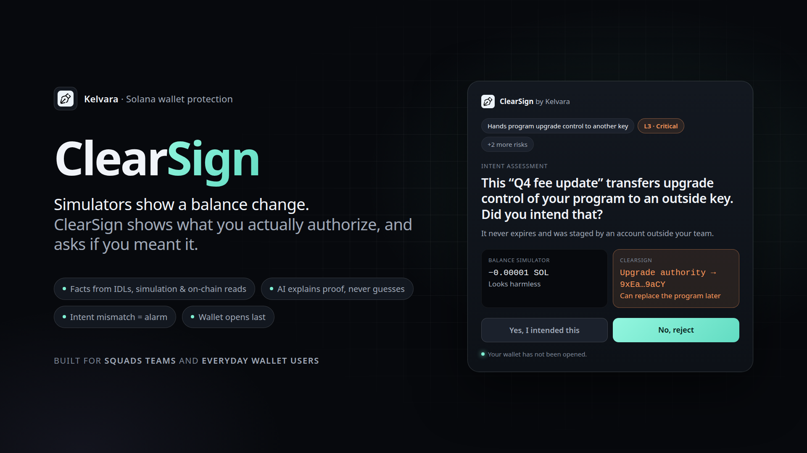

<p align="center">
  
</p>

<h1 align="center">Kelvara ClearSign</h1>

<p align="center">
  <b>Know what you sign.</b><br>
  A Chrome extension that holds every Solana signing request until you have seen, with proof, what the signature authorizes and confirmed it matches your intent.
</p>

<p align="center">
  <a href="#demo-video">Demo video</a> ·
  <a href="#how-it-works">How it works</a> ·
  <a href="#quick-start">Quick start</a> ·
  <a href="#test-playground">Playground</a> ·
  <a href="#security-model">Security model</a>
</p>

---

## Demo video

<!-- VIDEO PLACEHOLDER: replace the link and thumbnail below once the video is uploaded. -->
<p align="center">
  <a href="https://youtu.be/VIDEO_ID_HERE">
    
  </a>
  <br>
  <i>2-minute demo: coming soon</i>
</p>

## Why ClearSign

Wallets show bytes. Simulators show a balance change and a fee. Neither explains what runs underneath, how many instructions you sign, or the state you leave behind.

The dangerous transactions often move **zero balance today** and drain you later: a multisig vote that hands over a program's upgrade authority, a durable-nonce transaction that never expires, a token whose creator can take it back.

ClearSign is built for **teams running treasuries and programs on Squads** and for **everyday wallet users**.

| | Balance simulator | ClearSign |
|---|---|---|
| Shows the balance change | Yes | Yes |
| Names every instruction (from the program's IDL) | No | Yes |
| Decodes the inner instructions of Squads proposals | No | Yes |
| Shows permission and authority changes | No | Yes |
| Flags non-expiring (durable nonce) transactions | No | Yes |
| Explains slippage and fees in plain language | Partly | Yes |
| Asks what you meant before the wallet opens | No | Yes |

## How it works

1. **Hold.** The extension wraps Wallet Standard and legacy wallet APIs at `document_start`. Every signing call (transactions, messages, Sign-In With Solana) is held. The wallet does not open yet.
2. **Prove.** The service worker decodes the transaction with pinned IDLs and built-in decoders, simulates it, and reads chain state through Helius. Each finding is a claim graded *Fact*, *Derived* or *Unknown*, with its evidence attached.
3. **Ask.** Page 1 shows one plain-language question about the most consequential effect, for example *"This 'Q4 fee update' transfers upgrade control of your program to an outside key. Did you intend that?"* An optional AI provider can phrase and choose among engine-authored questions, but it cannot add facts, change risk levels or make signing decisions.
4. **Decide.** Answer *No, reject* and the wallet never opens. Answer *Yes* and page 2 shows the details: key risks, what changes, the simulation, compute and fees, and every decoded instruction with an Orb link. Only then can the request continue to the wallet.

**A mismatch between your intent and the proven effects is the alarm.**

### Alert levels

| Level | Meaning | What you see |
|---|---|---|
| **L4 Blocked** | Obvious scam: wallet sweep, address poisoning, owner/assign takeover, impostor site | Rejected at once; the wallet never opens; no Sign anyway |
| **L3 Critical** | Control of a program, multisig, mint or protocol admin passes outside the session | Held; Block is the default; Sign anyway needs hold-to-confirm |
| **L2 Warning** | Token-2022 trap extensions, unlimited allowance, foreign fee payer | Held; Block and Sign anyway side by side |
| **L1 Notice** | Worth knowing, e.g. first send to an address | Full report; Continue or Block |
| **L0 Clear** | Nothing found | Calm report; Continue or Block |

### Coverage

System, SPL Token, Token-2022, BPF Upgradeable Loader, Squads v4, Drift v2, marginfi v2, Kamino (Lending, Vault, Farms, Scope, Liquidity), Memo, Compute Budget, and the Ed25519 / secp256k1 / secp256r1 signature precompiles. Unknown programs are shown as unknown, never guessed.

### Impostor sites

Trusted dApps (Jupiter, Kamino and others) are matched by exact HTTPS origin. Look-alike domains (`jupiter-swap.app`, `jup.ag.evil.com`, `kam1no.com`, punycode or Cyrillic look-alikes, trusted sites over plain HTTP) are blocked as **L4 Impostor site** before any AI call.

## Quick start

Requirements: Node 22+, pnpm 10, Chrome 120+. The localnet gates and demo program also need the Solana CLI and `cargo-build-sbf`.

```sh
git clone https://github.com/kelvara-labs/kelvara-clearsign.git
cd kelvara-clearsign
cp .env.example .env          # add your HELIUS_API_KEY (never commit it)
pnpm install --frozen-lockfile
pnpm build
pnpm release                  # dist/kelvara-signguard.zip (reproducible, no key inside)
```

Load the extension:

1. Open `chrome://extensions` and enable **Developer mode**.
2. **Load unpacked** → `packages/extension/dist`.
3. Open ClearSign's **Options**, enter your Helius API key and pick mainnet or devnet.
4. Optional: under **Intelligence**, configure an OpenAI-compatible endpoint (e.g. `https://api.openai.com/v1/chat/completions` or a local `http://localhost:11434/v1`).

### Command line

```sh
node packages/cli/dist/kelvara.mjs analyze --network devnet --wallet <pubkey> --json <tx.b64>
node packages/cli/dist/kelvara.mjs replay <signature> [<signature> ...]
```

## Test playground

A devnet slide deck with five cases: a harmless memo (L0), a Token-2022 trap token (L2), a Squads "Q4 fee update" upgrade-authority hijack (L3), a genuine fee-change proposal (L1) and a wallet sweep (L4). The page only requests previews and never submits.

```sh
pnpm demo:prepare    # one-time: funds the shared devnet demo account
pnpm demo:serve      # http://localhost:47731
```

See [DEMO.md](DEMO.md) for the full runbook.

## Security model

- **Never signs, submits or stores wallet secrets.** It fails closed: any engine error, timeout, invalid report or hash mismatch blocks the request.
- **Helius is the only chain data provider.** There is no scanner, price feed, analytics or telemetry.
- **The AI is optional and grounded.** It runs only from the service worker, only against the endpoint you configure, and only after you grant host permission. It receives bounded engine-authored facts and questions. It never receives raw transaction bytes, signatures, wallet secrets or your Helius key. Its output is validated against the engine's candidate questions, and it falls back to the deterministic question on any failure.
- **The content scripts are minimal.** The page hook and bridge contain no engine or Solana libraries.
- **The release zip is reproducible** and contains no key.

## Repository layout

| Path | Contents |
|---|---|
| `packages/core` | Engine: decode, Helius reads, simulation, rules, capability graph, the `kelvara-report-v1` report |
| `packages/idls` | Pinned IDL registry, compact roots, capability and authority maps |
| `packages/cli` | `kelvara analyze` and `kelvara replay` |
| `packages/extension` | MV3 extension: page hook, bridge, service worker, report UI, popup, options |
| `packages/scenarios` | Localnet and devnet demo scenarios and the playground |
| `test-dapp` | Test page, test wallet and Playwright e2e specs |
| `tools/selfcheck` | The ten quality gates |
| `fixtures` | Real transactions from Helius or executed on localnet, with a manifest |

## Quality gates

`pnpm selfcheck` runs ten gates: G1 build, G2 decode, G3 rules, G4 report contract, G5 registry, G6 localnet scenarios, G7 browser e2e, G8 replay, G9 determinism, G10 security. `pnpm selfcheck --fast` runs G1–G4. Results and evidence are in [SELFCHECK.md](SELFCHECK.md).

## Known limitations

- History reads stop at 1,000 signatures per address (30 days).
- Registry IDLs whose IDL authority differs from the upgrade authority (or that are immutable) are labelled lower confidence.
- Offline replay cannot read nonce creators or multisig state, so those claims are marked Unknown.
- Re-analyzing an already executed transaction uses today's chain state.
- Market-specific amounts in some third-party programs are shown in base units when their decimals cannot be proven.

## How this was built

ClearSign was built during a hackathon by a coordinated team of AI agents (engine, extension, scenarios, verifier and designer), each in its own worktree. The operating rules, plan and progress logs are kept in the repo: [CLAUDE.md](CLAUDE.md), [PLAN.md](PLAN.md), [PROGRESS.md](PROGRESS.md) and [`progress/`](progress/).

Third-party code and dependency licenses: [LICENSES.md](LICENSES.md).

## License

Copyright © Kelvara. All rights reserved. The source is public for review and evaluation. No license to use, copy, modify or distribute it is granted.
